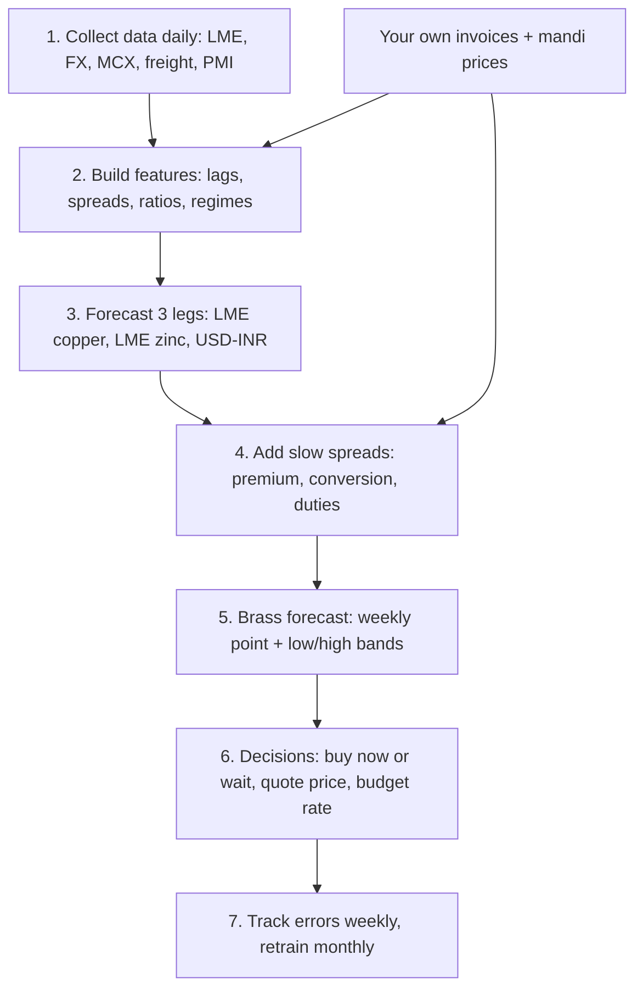
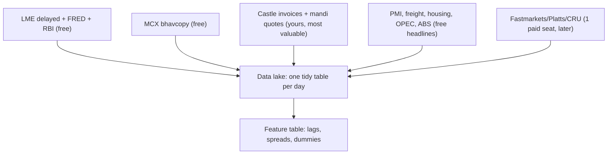
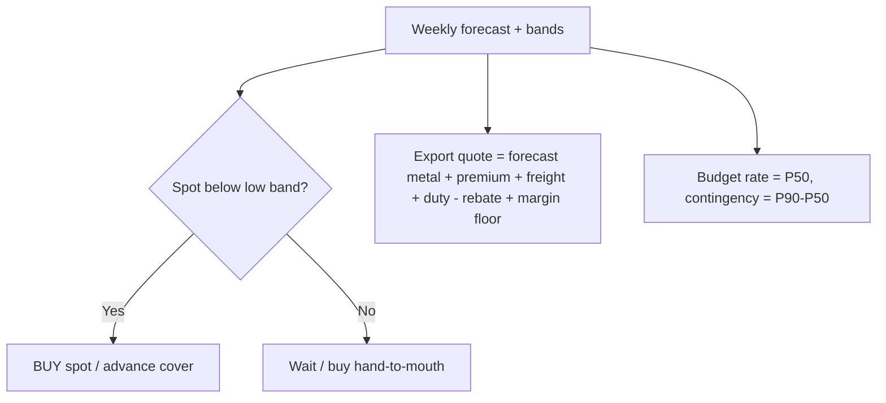
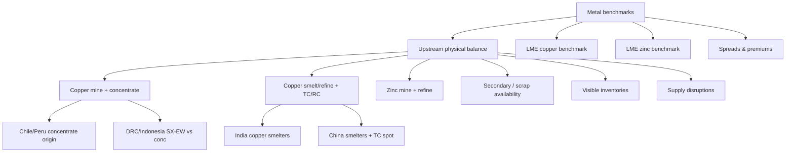
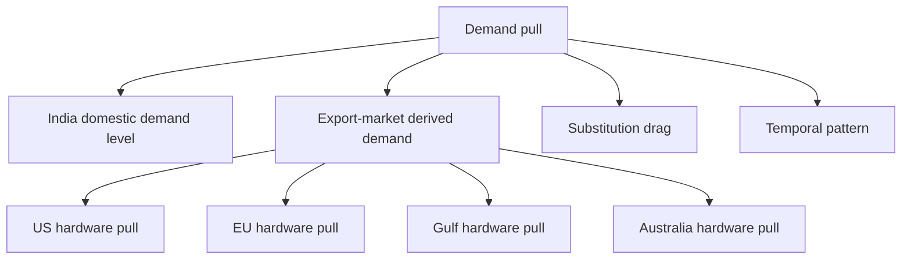
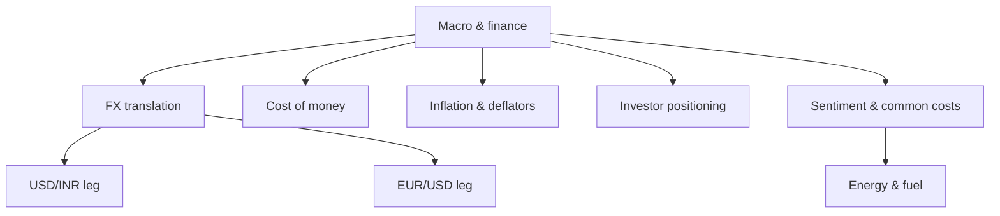
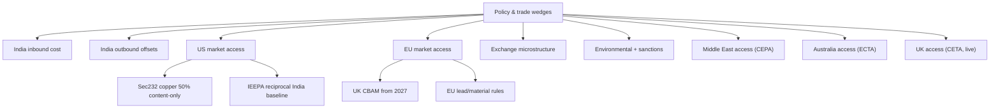
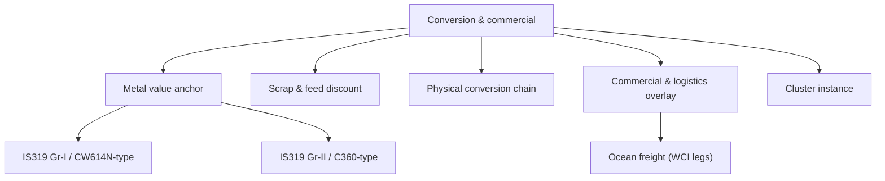

# Brass Price Forecasting System — Product Requirements Document
*Castle Hardware · plain-English edition for the full team · generated 2026-10-02 from 72 verified nodes*

## 1. Problem, in one paragraph
Castle buys brass raw material in India (rupees, mostly spot) and sells finished hardware to Europe, the US, the Middle East and Australia. Brass prices swing hard, there is no hedge in place, and today buying and quoting are done on gut feel. This system replaces gut feel with a weekly forecast plus budget bands, so procurement buys at better moments, sales quotes protect margin, and finance plans with ranges instead of single numbers.

## 2. How the brass price actually works (the one formula that matters)
There is no brass futures market anywhere. Your rod price is always built from parts:
```
INR per kg = (copper share x LME copper x USD-INR) + (zinc share x LME zinc x USD-INR)
             + fabrication premium - scrap discount + conversion + dealer margin
             + freight + net duties and taxes
```
Example: a 60/40 rod at LME copper $13,500 and zinc $3,500 with USD-INR 95 gives metal value near Rs 850/kg before any premium, conversion, freight or duty. Everything in this document is either a part of that sum, something that moves a part, or a timer that says when a part moves.

## 3. Whole system at a glance


## 4. Data: where every number comes from

Full source register: 35 cited claims in output/claim_ledger.csv, 34 datasets in output/data_catalogue.csv. Free first, paid only where free cannot reach (premiums, scrap spreads). Your own purchase history is the proprietary label no competitor has.

## 5. How the drivers connect (correlations without fairy tales)
Rule: a connection is only used if a source proves the arrow, not just the two boxes. 9 connections made the cut; quantified strengths stay in the watchlist until estimated honestly.
- **FX translation → LME copper benchmark** (causal, negative, lag contemporaneous/days, Disputed): Stronger dollar makes dollar-priced copper mechanically dearer for non-US buyers, denting demand.
- **Copper smelt/refine + TC/RC → Upstream physical balance** (causal, positive (tightness up -> supply down -> price up), lag months (annual benchmark + spot lead), Verified): Zero processing margin forces custom smelters to cut/close, capping refined output.
- **LME copper benchmark → Secondary / scrap availability** (feedback loop, negative feedback, lag weeks-months, Disputed): Record Cu incentivises collection + feed switch to scrap (TC-free), partly offsetting concentrate gap.
- **US market access → Visible inventories** (causal, positive, lag weeks; reversible on exemption/delay, Verified): Phased-tariff expectation widens COMEX premium, pulling metal to US and draining LME/SHFE.
- **Sentiment & common costs → India domestic demand level** (causal, positive, lag 1-2 months to stocks/premia, Disputed): China ~58-60% refined use; sub-50 PMI maps to cathode/rod order cuts and SHFE builds.
- **LME copper benchmark → Substitution drag** (substitution, negative, lag 6-18 months qualification, Verified): At >3.5-4x, cable/winding/EV qualify aluminium, shaving copper demand.
- **LME copper benchmark → Metal value anchor** (causal, positive, lag daily, Verified): Rs/kg = LME $/t /1000 x USD/INR x (1+duty/freight/margin). 1% INR slip ~= Rs10-13/kg at $13-14k/t.
- **Cost of money → India domestic demand level** (causal, negative, lag 1-3 quarters, Disputed): Higher rates curtail building/auto/grid capex to which brass demand is geared.
- **Sentiment & common costs → Commercial & logistics overlay** (causal, positive, lag 1-3 months, Disputed): $100+/bbl + Cape detour (+8-12d) + war-risk/ETS lifts Asia-Europe spot, passing to imports.

## 6. Model design: what we forecast and how we win
- **Targets:** LME copper, LME zinc, USD-INR (the 3 moving legs) → combined by the formula into brass INR/kg. Spreads modelled separately as slow-moving add-ons.
- **Horizons:** weekly 1–8 weeks (buy timing) + quarterly (budgets). Two small models, not one big one.
- **Features from the driver map:** last 8 weekly lags of each leg; LME spreads (cash-minus-3-month); USD-INR momentum; scrap/premium proxies; PMI new-orders-minus-stocks; positioning z-scores; event dummies (tariff dates, CBAM dates, strikes); interaction terms (copper × FX, high-price × volume).
- **Candidates, in order:** (1) naive carry-forward baseline — must beat this or stop; (2) LightGBM direct multi-horizon regression — likely champion on small noisy data; (3) elastic-net (stable, interpretable); (4) N-HiTS/TFT deep models only if 3+ years of clean history exists. Ensemble of 2+3 for production.
- **Output is a range, not a number:** quantile bands P10/P50/P90 so finance gets budget bands and procurement gets buy triggers (e.g. buy when spot is below P25 of the 4-week forecast).
- **Validation that prevents lying to ourselves:** walk-forward time splits with embargo gaps, no future data leaks (respect publication lags: PMI monthly, COT Tue/Fri, LME next-day), metrics MAE/RMSE vs naive + directional hit-rate + the only metric that matters: rupees saved in a buying backtest against your actual invoices.
- **Where to train:** Kaggle free tier (notebooks + 30h/week GPU; this workload runs fine on CPU) for experiments; monthly retrain as a scheduled job; model files versioned (v1, v2…) so any forecast is reproducible.

## 7. Decisions the system produces


## 8. Why competitors cannot copy this (moat)
LME prices are public. Your edge is: (a) your own invoice + premium + scrap-mix history — the true labels; (b) mandi spread tracking only an Indian buyer sees; (c) spread models for conversion/premia; (d) execution discipline from weekly signals. None of that is downloadable.

### Castle brass price  [Verified]
- **What it is:** Total INR cost per kg delivered rod/strip + export margin. Identity in meta.
- **Includes:** Metal value + spreads + duties + demand/positioning timing effects.
- **Leaves out (counted elsewhere):** Nothing - root covers all; children partition it.

## 9.1 Branch: Supply: metal benchmarks + upstream
If metal is scarce, your raw material costs more. This branch watches mines, smelters, scrap and stockpiles.
### Metal benchmarks  [Verified]
- **What it is:** Global USD benchmarks Castle takes as given. No brass future.
- **Includes:** LME Cu/Zn Official, Settlement, MASP, Closing, COMEX HG, spreads.
- **Leaves out (counted elsewhere):** Physical tonnes, FX, duties, India spreads (other branches).


### Upstream physical balance  [Verified]
- **What it is:** Upstream physical balance that drives benchmarks with lag.
- **Includes:** Mine, smelter, scrap availability, stocks, disruptions.
- **Leaves out (counted elsewhere):** Prices themselves, FX, duties.

### Copper mine + concentrate  [Disputed]
- **What it is:** Extraction to concentrate. ICSG balances drive outlook.
- **Includes:** World mine output, Chile/Peru/DRC/Indonesia, India HCL ore, grades.
- **Leaves out (counted elsewhere):** Smelter output, TC/RC economics (S2), prices.
- **Trust note:** ICSG 2025: 1.4% growth, 178kt surplus; 2026 deficit 150kt (R1 verified via Reuters, R2 unverified PDF-gated). Use as Disputed with vintage.

### Chile/Peru concentrate origin  [Disputed]
- **What it is:** Grade decline + incidents (Escondida -300kt to 1.1Mt 2027 guide; El Teniente -33kt). Drives TC.
- **Includes:** Mine output, grades, incidents.
- **Leaves out (counted elsewhere):** DRC/Indonesia SX-EW.
- **Trust note:** Single-press incident R1; use as dummies.

### DRC/Indonesia SX-EW vs conc  [Disputed]
- **What it is:** Kakula flood May-2025; Grasberg -32% conc; DRC SX-EW +8% vs conc -34% H1-2026.
- **Includes:** Flood/mud-rush dummies, SX-EW split.
- **Leaves out (counted elsewhere):** Chile/Peru.

### Copper smelt/refine + TC/RC  [Verified]
- **What it is:** Custom smelters + refineries + SX-EW. TC/RC signals tightness.
- **Includes:** TC/RC benchmark + spot, cathode output, capacity/utilisation, Kutch/Hindalco.
- **Leaves out (counted elsewhere):** Mining, semis rolling.
- **Trust note:** TC $0/t 2026 vs $21.25 2025 verified R1 (Reuters/Kitco) + R2-policy (Reuters/CRU). Spot negative separate. Kutch Phase-1 0.5Mtpa commissioned 28-Mar-2024 VERIFIED (Adani); 1Mtpa = full target.

### India copper smelters  [Verified]
- **What it is:** Dahej (Hindalco, largest custom), Kutch Phase-1 0.5Mtpa 28-Mar-2024, Tuticorin 0.4Mtpa idle since May-2018.
- **Includes:** Capacity, utilisation, ramp timelines.
- **Leaves out (counted elsewhere):** China smelters.
- **Trust note:** Commissioning dates verified; utilisation levels gap.

### China smelters + TC spot  [Verified]
- **What it is:** Concentrate tightness -> spot TC negative, benchmark $0/t 2026.
- **Includes:** Spot TC (Fastmarkets/Mysteel), maintenance hits.
- **Leaves out (counted elsewhere):** India capacity.

### Zinc mine + refine  [Disputed]
- **What it is:** Zinc ore to metal. HZL anchors India.
- **Includes:** World Zn mine/refined (ILZSG), HZL mined/refined, Zn TC.
- **Leaves out (counted elsewhere):** Cu legs, galvanising demand.
- **Trust note:** HZL FY25 1095kt mined/1052kt refined: R1 verified via BusinessWire/Vedanta, R2 unverified (JS site). Mark Disputed pending annual-report page. ILZSG balance numbers quarantined to ledger.

### Secondary / scrap availability  [Verified]
- **What it is:** Collection to secondary refined + direct-melt. Price-elastic buffer.
- **Includes:** Old/new Cu scrap, brass honey scrap, secondary refined, scrap imports India.
- **Leaves out (counted elsewhere):** Primary mine/smelter tonnes.
- **Trust note:** Mechanism verified (ICSG secondary +5.7% vs primary +2.3% via ICSG PR reported press). Elasticity magnitude quarantined.

### Visible inventories  [Verified]
- **What it is:** Exchange + off-warrant + producer/consumer + state stocks. Buffer, not flow.
- **Includes:** LME stocks/cancelled/on-warrant daily, SHFE weekly, bonded, SRB.
- **Leaves out (counted elsewhere):** Futures curve as price signal (MAC).
- **Trust note:** LME daily + SHFE weekly reporting existence VERIFIED. Levels themselves are data, not claims.

### Supply disruptions  [Disputed]
- **What it is:** Discrete events removing S1-S5 tonnes. Dummies, not levels.
- **Includes:** Accidents, strikes, power, grade, bans, logistics blocks.
- **Leaves out (counted elsewhere):** Chronic capacity trends (in S1-S4).
- **Trust note:** Event list (Kakula flood, El Teniente, Grasberg, Chile blackout) single-trade-source; use as event dummies to verify per-incident.

### LME copper benchmark  [Verified]
- **What it is:** LME Cu benchmark formation.
- **Includes:** Official, Settlement, MASP, Closing, cash-3M spread, COMEX HG + arb.
- **Leaves out (counted elsewhere):** Zn, FX, physical tonnes.
- **Trust note:** LME 25t lot USD/t VERIFIED; Official = Ring2 last bid/offer + Settlement last cash offer VERIFIED; MASP VWAP-window detail QUARANTINED to ledger; COMEX 25klb specs quarantined pending rulebook.

### LME zinc benchmark  [Verified]
- **What it is:** LME Zn benchmark. ~35-40% of 60/40 cost.
- **Includes:** Zn Official/Settlement/3M, Zn stocks tightness feed.
- **Leaves out (counted elsewhere):** Cu leg.

### Spreads & premiums  [Disputed]
- **What it is:** Benchmark spreads signalling tightness: LME cash-3M, COMEX-LME arbitrage, cathode/zinc premiums, Yangshan premium; SHFE lens on China.
- **Includes:** Backwardation/contango, warrant-cancel ratio, arb spread.
- **Leaves out (counted elsewhere):** Outright price levels (M_CU/M_ZN).
- **Trust note:** Premia levels paid (Fastmarkets/Platts/CRU); spreads free-delayed. Single round on arb evidence.

## 9.2 Branch: Demand pull
Strong demand lets mills charge more and keeps your order book full; weak demand does the opposite.
### Demand pull  [Disputed]
- **What it is:** Where brass is finally consumed. Drives volume + pass-through.
- **Includes:** India level, export pull, substitution share, temporal pattern.
- **Leaves out (counted elsewhere):** Prices, FX, duties.


### India domestic demand level  [Disputed]
- **What it is:** Total copper+brass consumed India. Castle buys here.
- **Includes:** Construction/plumbing, electrical, auto, machinery/durables, defence.
- **Leaves out (counted elsewhere):** Export volumes, substitution share.
- **Trust note:** ICA FY25 1878kt +9.3% (building +11% infra +17%) UNVERIFIED (HTML only, PDF pending) - quarantined numbers; mechanism kept Disputed. CSEP 3.24Mt conventional +274kt transition by FY30: R2 verified via csep.org, R1 quarantined - Disputed pending second round.

### Export-market derived demand  [Disputed]
- **What it is:** Demand for finished hardware installed US/EU. Drives Castle orders.
- **Includes:** US housing starts/permits, construction spend, EU construction prod, HS imports (7412/8481/8302).
- **Leaves out (counted elsewhere):** India volumes.
- **Trust note:** USGS/CDA shares VERIFIED as vintage ranges (building 42-45% per MCS2024-25, electrical 22-23%) - cite with year; single-year point without vintage DISPUTED. HS import volumes not retrieved - gap.

### US hardware pull  [Disputed]
- **What it is:** Housing starts/permits (FRED HOUST), construction spend, HS 7412/8481/8302 imports.
- **Includes:** Residential + nonres construction.
- **Leaves out (counted elsewhere):** EU pull.
- **Trust note:** Shares vintage-gated; HS volumes gap.

### EU hardware pull  [Disputed]
- **What it is:** EU construction production (Eurostat), CBAM/safeguard-gated demand.
- **Includes:** Construction prod + import TRQ fill.
- **Leaves out (counted elsewhere):** US pull.
- **Trust note:** US shares verified; EU construction proof pending: Eurostat sts_copr_m + Comext HS to pull.

### Gulf hardware pull  [Disputed]
- **What it is:** Oil-funded Gulf construction; OPEC MOMR monthly as spending-power proxy; UAE re-export channel.
- **Includes:** ORB/Brent, Gulf PMI, awards (MEED paid).
- **Leaves out (counted elsewhere):** Tariffs (P_ME).

### Australia hardware pull  [Disputed]
- **What it is:** ABS Building Approvals monthly + RBA cash-rate cycle; ECTA zero-duty from 2026.
- **Includes:** Approvals, alterations, rate pass-through.
- **Leaves out (counted elsewhere):** Origin rules (P_AU).

### Substitution drag  [Disputed]
- **What it is:** Share loss to other materials. Multiplies levels, not level itself.
- **Includes:** PEX/plastic vs tube, Al vs Cu, steel vs brass, lead-free alloy shift.
- **Leaves out (counted elsewhere):** Demand levels, cycles.
- **Trust note:** Share-loss series: PEX pipe (Freedonia, paid), BLS PPI plastic vs copper-base — to pull before modelling.

### Temporal pattern  [Disputed]
- **What it is:** Cycle + seasonality + elasticity modulating D1/D2 into weekly vs long-term.
- **Includes:** Business cycle, seasonality dummy, short-run price elasticity/destocking.
- **Leaves out (counted elsewhere):** Levels, shares.
- **Trust note:** Seasonality estimated in-sample from LME/COMEX history; Seasonax (paid) optional.

## 9.3 Branch: Macro and money
Exchange rates and interest rates decide what a dollar-priced metal costs you in rupees, and what your exports earn.
### Macro & finance  [Verified]
- **What it is:** Translation + expectations holding physical tonnes constant.
- **Includes:** FX, rates, inflation, positioning, sentiment, common costs.
- **Leaves out (counted elsewhere):** Physical tonnes, duties.


### FX translation  [Verified]
- **What it is:** USD metal to INR cost + EUR/USD revenue.
- **Includes:** USD/INR FBIL/RBI, EUR/INR cross, EUR/USD, DXY.
- **Leaves out (counted elsewhere):** Real purchasing power (inflation).
- **Trust note:** RBI archive+Excel, FRED DEXINUS/DEXUSEU/DTWEXBGS, ECB ref rates existence VERIFIED. FBIL VWAP-window detail quarantined. Identity LME*FX->INR VERIFIED as accounting.

### USD/INR leg  [Verified]
- **What it is:** RBI/FBIL ref + FRED DEXINUS cross-check. Drives INR cost tick-for-tick.
- **Includes:** Daily ref, forwards premium.
- **Leaves out (counted elsewhere):** EUR legs.

### EUR/USD leg  [Verified]
- **What it is:** ECB ref + FRED DEXUSEU. Drives export realisation.
- **Includes:** EUR/USD + EUR/INR cross.
- **Leaves out (counted elsewhere):** USD/INR domestic leg.

### Cost of money  [Verified]
- **What it is:** Policy + market rates changing carry, finance, USD.
- **Includes:** Fed funds, ECB deposit/MRO, RBI repo/stance, real yields.
- **Leaves out (counted elsewhere):** Earnings, PMI sentiment.
- **Trust note:** Fed 3.75-4.00% post 16-Sep-2026 hike VERIFIED; ECB deposit 2.50% post 16-Sep-2026 VERIFIED; RBI repo 5.25% Aug-2026 single-round (quarantine detail, keep level Disputed if modelling).

### Inflation & deflators  [Verified]
- **What it is:** General price level forcing nominal pass-through.
- **Includes:** US CPI/core, Euro HICP, India CPI/food/core.
- **Leaves out (counted elsewhere):** Metal premia.
- **Trust note:** US CPI Aug-2026 +3.4% y/y +0.4% m/m VERIFIED (BLS). India CPI 4.82% single-round - Disputed.

### Investor positioning  [Verified]
- **What it is:** Non-physical flows moving futures short-term.
- **Includes:** CFTC COT/disaggregated, LME COTR, OI, vol.
- **Leaves out (counted elsewhere):** Physical stocks.
- **Trust note:** CFTC Tue-positions/Fri-release VERIFIED. LME COTR existence verified, exact cited URL 404 - use current LME path.

### Sentiment & common costs  [Disputed]
- **What it is:** Forward activity + shared input costs.
- **Includes:** Mfg PMI + Copper Users PMI, equities, industrial power, crude/gas, BDI.
- **Leaves out (counted elsewhere):** End-use tonnes, vessel logistics.
- **Trust note:** PMI diffusion method general VERIFIED concept; specific India/US/EU PMI prints quarantined. BDI 40/30/30 composition quarantined pending Baltic manual. Energy/freight as cost push directional.

### Energy & fuel  [Verified]
- **What it is:** Fuel/power costs feeding smelting, fabrication and freight: Brent, Henry Hub/EU gas, Indian Basket + petrol/diesel RSP, industrial power tariffs.
- **Includes:** Daily Brent, weekly gas, PPAC basket/RSP, EIA power prices.
- **Leaves out (counted elsewhere):** Metal prices themselves.

## 9.4 Branch: Policy and trade
Duties, bans, standards and carbon taxes add costs or open doors in each country you buy from or sell to.
### Policy & trade wedges  [Verified]
- **What it is:** Jurisdiction rules taxing inbound, subsidising outbound, taxing destination.
- **Includes:** India inbound, India outbound offsets, US wall, EU wall, LME rules, env/sanctions.
- **Leaves out (counted elsewhere):** LME formation, physical tonnes.


### India inbound cost  [Disputed]
- **What it is:** Central taxes + clearances before melt shop.
- **Includes:** BCD/AIDC/SWS/IGST HS7403/7404/7901, FTA, BIS QCO, scrap NOC.
- **Leaves out (counted elsewhere):** Destination tariffs, export rebates.
- **Trust note:** BCD nil on copper scrap from 2-Feb-2025 VERIFIED R2 (Budget/CBIC/PIB/Reuters); R1 quarantined - Disputed per strict rule. BIS QCO: 2024 S.O.1801(E) issued VERIFIED but 2023 withdrawn Nov-2025 + 2024 ambiguous - DISPUTED as active blanket, check current BIS list.

### India outbound offsets  [Disputed]
- **What it is:** Rebates lowering net FOB INR.
- **Includes:** RoDTEP 4R/4RE, drawback Ch74/83, advance auth, GST zero-rating.
- **Leaves out (counted elsewhere):** Buyer duties.
- **Trust note:** RoDTEP mechanism VERIFIED; rates MUST be vintage-stamped (cut to 50% 23-Feb-2026, restored 23-Mar-2026, extended to 31-Dec-2026 per DGFT 60/66/74). Drawback-ban claim DISPUTED (no ban found, regime active).

### US market access  [Verified]
- **What it is:** US duties/carbon levied at import. Discount-or-lose-volume.
- **Includes:** Sec232 Cu 50% content-only, steel/alu derivatives, IEEPA reciprocal India, MFN, AD/CVD.
- **Leaves out (counted elsewhere):** LME formation.
- **Trust note:** Sec232 50% semis+derivatives eff 1-Aug-2025, content-only, ores/cathodes/scrap EXCLUDED VERIFIED (WH + FR 2025-14893, two rounds). US-India IEEPA 50%->18% Feb-2026 VERIFIED R2 (WH/Reuters); R1 quarantined - Disputed per strict rule, do not conflate with 232.

### Sec232 copper 50% content-only  [Verified]
- **What it is:** Semis + intensive derivatives, copper-content value only, eff 1-Aug-2025. Ores/cathodes/scrap excluded.
- **Includes:** Annex HTS, CBP content declaration, no-stack with auto-232.
- **Leaves out (counted elsewhere):** IEEPA reciprocal.

### IEEPA reciprocal India baseline  [Disputed]
- **What it is:** India-country rate (50% Aug-2025 -> 18% Feb-2026 framework). Applies to non-copper content of brass goods.
- **Includes:** Country rate timeline, transhipment 40%.
- **Leaves out (counted elsewhere):** 232 content duty.
- **Trust note:** R2-primary vs R1-quarantine; do not stack with 232.

### EU market access  [Verified]
- **What it is:** EU carbon/border costs.
- **Includes:** CBAM definitive, steel Reg 2026/1384 TRQ, sanctions bans.
- **Leaves out (counted elsewhere):** US regime.
- **Trust note:** CBAM definitive 1-Jan-2026, 6 sectors, brass/copper OUT VERIFIED (Reg 2023/956 + EC). 2028 downstream-extension proposal flagged, not adopted. Steel Reg 2026/1384 18.3Mt/50% from 1-Jul-2026 VERIFIED R2 (EUR-Lex); R1 quarantined - Disputed strict.

### UK CBAM from 2027  [Verified]
- **What it is:** UK tax on embodied emissions for imports from 1-Jan-2027: aluminium, cement, fertiliser, hydrogen, iron & steel. Registration from 1-Jan-2028. Brass/copper out (as EU).
- **Includes:** Finance Act 2026 Sch17, SI 2026/802 + 809, quarterly CBAM rate, carbon price relief.
- **Leaves out (counted elsewhere):** EU CBAM (P4); indirect emissions (out at implementation).
- **Trust note:** R2-policy flagged + direct GOV.UK fetch 2026-10-02.

### EU lead/material rules  [Disputed]
- **What it is:** DWD recast: lead 10->5 ug/L by 2036; EU hygiene standards + conformity marking from 31/12/2026; lead-free grade cost delta open.
- **Includes:** EN 15664 testing, positive list, national transpositions.
- **Leaves out (counted elsewhere):** Carbon duties (P4).

### Exchange microstructure  [Disputed]
- **What it is:** LME rulebook altering premium/queue/warrant, not govt tax.
- **Includes:** LILO, load-out minima, rent caps, brand listing, sanctions attestation.
- **Leaves out (counted elsewhere):** Govt tariffs.
- **Trust note:** LILO+QBRC from 1-May-2016 VERIFIED historic (R2); current calibration under 2026 review - vintage required.

### Environmental + sanctions  [Disputed]
- **What it is:** Global cost-raising rules shifting LME + scrap for all buyers.
- **Includes:** India EPR 1-Apr-2026, NFM recycling framework, mine royalties, RU sanctions.
- **Leaves out (counted elsewhere):** Product QCO.
- **Trust note:** EPR 18 non-ferrous products from 1-Apr-2026 VERIFIED R2 (MoEFCC/CPCB); R1 quarantined - Disputed strict.

### Middle East access (CEPA)  [Disputed]
- **What it is:** UAE CEPA in force May-2022 (97.4% lines zero) + GCC 5% CET baseline off-CEPA; Jebel Ali re-export hub; dirham settlement.
- **Includes:** CoO CTH+RVC>=35%, TRQ/origin policing.
- **Leaves out (counted elsewhere):** EU/US/AU regimes.
- **Trust note:** Search-level; pull UAE schedule + Commerce text for brass HS.

### Australia access (ECTA)  [Disputed]
- **What it is:** ECTA in force 29-Dec-2022; 100% of imports from India tariff-free from 1-Jan-2026; ABF Schedule 10A; CECA talks resumed.
- **Includes:** Scheme IECT, origin rules, dumping-duty watch.
- **Leaves out (counted elsewhere):** AU demand (D2_AU).

### UK access (CETA, live)  [Disputed]
- **What it is:** UK-India CETA in force 15-Jul-2026: 99% of Indian goods duty-free into UK; Ch.2 + Annex 2A-b; QCO/non-tariff watch.
- **Includes:** Brass-hardware tariff lines, origin rules.
- **Leaves out (counted elsewhere):** UK CBAM 2027 (P4_UK).
- **Trust note:** Line-level brass check pending.

## 9.5 Branch: Conversion and commercial (India)
This is the India-specific layer: turning metal into rod, dealer margins, freight and local clusters.
### Conversion & commercial  [Disputed]
- **What it is:** Melt-to-gate INR spreads under no-hedge spot buying.
- **Includes:** Alloy math, scrap discount spread, melt/extrude/finish charges, dealer/freight/carry, cluster.
- **Leaves out (counted elsewhere):** LME level, FX, duties, demand volumes.


### Metal value anchor  [Verified]
- **What it is:** LME-derived intrinsic alloy value before work.
- **Includes:** LME Cu/Zn x USDINR x alloy %, MCX Cu/Zn/BRASS ref, IS319/CW614N/C360 math.
- **Leaves out (counted elsewhere):** Labour, energy, margins.
- **Trust note:** Alloy math ranges VERIFIED (IS319 Gr-I 56-59% Pb2-3.5, Gr-II 60-63% Pb2.5-3.7; C260 70/30; C360 60-63%; Naval 60/39.25/0.75Sn). MCX Cu compulsory delivery VERIFIED; MCX brass 2018 1t VERIFIED historical, absent 2026 list - time-qualify.

### IS319 Gr-I / CW614N-type  [Verified]
- **What it is:** Cu 56-59%, Pb 2.0-3.5%, Zn remainder. Free-cutting rod.
- **Includes:** Rod/bar spec windows.
- **Leaves out (counted elsewhere):** Gr-II chemistry.

### IS319 Gr-II / C360-type  [Verified]
- **What it is:** Cu 60-63%, Pb 2.5-3.7%, Zn remainder. Higher-Cu rod.
- **Includes:** Rod spec windows.
- **Leaves out (counted elsewhere):** Gr-I chemistry.

### Scrap & feed discount  [Disputed]
- **What it is:** Discount of honey/cuttings to LME blend.
- **Includes:** Imported honey discount, domestic purja/honey/chadar vs virgin spread, billet CFR ratio.
- **Leaves out (counted elsewhere):** Melt energy.
- **Trust note:** Honey-at-discount-to-LME mechanism VERIFIED via Hindu 2018; discount % + billet 62.5-63.5% LME ratio single-source (SMM) - Disputed; do not conflate composition % with price ratio.

### Physical conversion chain  [Disputed]
- **What it is:** Step charges melt to finished form.
- **Includes:** Melt, extrude/draw 2-100mm, finish/CNC/plate/OES, yield loss, temper.
- **Leaves out (counted elsewhere):** Trader margin, freight.
- **Trust note:** Rs14-18/kg scrap->billet 2018 single anecdote QUARANTINED for weekly model; mechanism kept Disputed. 1-2wk LME pass-through lag VERIFIED R1 via Anand Brass 2026-04-27 (single trade source) - Disputed strict, model as lag to estimate.

### Commercial & logistics overlay  [Disputed]
- **What it is:** Non-metallurgical add-ons for spot/weekly buying.
- **Includes:** Dealer premium, MOQ/1T lot, port/demurrage, FOB Mundra/Kandla, sea freight, FX carry, export markup.
- **Leaves out (counted elsewhere):** LME level.
- **Trust note:** Mundra/Kandla demurrage + FOB + 25-30d US/18-22d EU transit single-vendor - Disputed. Dealer margins/premia: no citable source - gap.

### Ocean freight (WCI legs)  [Disputed]
- **What it is:** Container freight for inbound scrap/semis + outbound hardware: WCI composite + Shanghai-Rotterdam/Genoa/LA/NY legs; blank sailings, ETS/ETS surcharges, Red Sea/Cape routing.
- **Includes:** WCI weekly Thursday, 8-lane legs, Red Sea diversion tracker.
- **Leaves out (counted elsewhere):** Dry-bulk BDI (F5); inland trucking (PPAC RSP).
- **Trust note:** Single round; India-specific legs to calibrate.

### Cluster instance  [Disputed]
- **What it is:** Where conversion happens. Functional split, not macro.
- **Includes:** Jamnagar industrial rod/parts; Moradabad decor; unit counts, export shares.
- **Leaves out (counted elsewhere):** National macro drivers.
- **Trust note:** Jamnagar 3000/5000 units 80% sold-India (2018 Hindu) vs 5000+ Jamnagar 80% exports (2026 vendor) conflict denominators - Disputed. Moradabad 600 export + NIC economy page VERIFIED existence; 7000cr turnover single-press Disputed.

## 9.6 Branch: Watchlist (unsourced)
Things that probably matter but have no reliable source yet. Visible so nobody forgets them. Do not use in the model until sourced.
### Watchlist: needs source  [Unverified]
- **What it is:** Unevidenced but material factors, kept visible per owner instruction. Grey = do not model until sourced.
- **Includes:** 14 hypotheses + evidence needed each.
- **Leaves out (counted elsewhere):** Verified/Disputed graph (siblings).
- **Trust note:** Container for unevidenced hypotheses; each lists evidence needed.

```mermaid
graph TD
    WATCH["Watchlist: needs source"] --> W_MGN["Dealer margins / premia"]
    WATCH["Watchlist: needs source"] --> W_CONV["Live conversion Rs/kg"]
    WATCH["Watchlist: needs source"] --> W_MND["Mandi rod premium"]
    WATCH["Watchlist: needs source"] --> W_HNY["Honey discount live"]
    WATCH["Watchlist: needs source"] --> W_CARRY["Inventory carry cost"]
    WATCH["Watchlist: needs source"] --> W_PWR["Foundry power tariff"]
    WATCH["Watchlist: needs source"] --> W_MON["Monsoon magnitude"]
    WATCH["Watchlist: needs source"] --> W_EUCOM["EU import volumes"]
    WATCH["Watchlist: needs source"] --> W_MEDEM["Gulf demand series"]
    WATCH["Watchlist: needs source"] --> W_AUDEM["AU demand detail"]
    WATCH["Watchlist: needs source"] --> W_PB["Lead-free cost delta"]
    WATCH["Watchlist: needs source"] --> W_GST["GST schedule check"]
    WATCH["Watchlist: needs source"] --> W_BETA["USD beta quantified"]
    WATCH["Watchlist: needs source"] --> W_ELAS["Scrap elasticity quantified"]
```


### Dealer margins / premia  [Unverified]
- **What it is:** Dealer net margins over LME-implied metal value by channel.
- **Includes:** Evidence needed: 3+ dealer quotes or mandi series.
- **Leaves out (counted elsewhere):** Modelled drivers (siblings).
- **Trust note:** Source needed — see gap row.

### Live conversion Rs/kg  [Unverified]
- **What it is:** Current scrap->billet/rod jobwork charge (2018 figure stale).
- **Includes:** Evidence needed: 2026 foundry quotes.
- **Leaves out (counted elsewhere):** Modelled drivers (siblings).
- **Trust note:** Source needed — see gap row.

### Mandi rod premium  [Unverified]
- **What it is:** Finished-rod premium over alloy metal value by spec/dia.
- **Includes:** Evidence needed: mandi price lists.
- **Leaves out (counted elsewhere):** Modelled drivers (siblings).
- **Trust note:** Source needed — see gap row.

### Honey discount live  [Unverified]
- **What it is:** Brass scrap discount % to LME blend, import vs domestic.
- **Includes:** Evidence needed: BigMint/RecycleInMe or importer quotes.
- **Leaves out (counted elsewhere):** Modelled drivers (siblings).
- **Trust note:** Source needed — see gap row.

### Inventory carry cost  [Unverified]
- **What it is:** MCLR + forward premia cost of unhedged stock.
- **Includes:** Evidence needed: FBIL forwards + bank MCLR.
- **Leaves out (counted elsewhere):** Modelled drivers (siblings).
- **Trust note:** Source needed — see gap row.

### Foundry power tariff  [Unverified]
- **What it is:** State power/fuel cost for melt shops.
- **Includes:** Evidence needed: discom orders + fuel bills.
- **Leaves out (counted elsewhere):** Modelled drivers (siblings).
- **Trust note:** Source needed — see gap row.

### Monsoon magnitude  [Unverified]
- **What it is:** Rain disruption to mining/logistics/construction.
- **Includes:** Evidence needed: IMD + delay attribution.
- **Leaves out (counted elsewhere):** Modelled drivers (siblings).
- **Trust note:** Source needed — see gap row.

### EU import volumes  [Unverified]
- **What it is:** HS 7412/8481/8302 volumes from Comext.
- **Includes:** Evidence needed: Eurostat pull.
- **Leaves out (counted elsewhere):** Modelled drivers (siblings).
- **Trust note:** Source needed — see gap row.

### Gulf demand series  [Unverified]
- **What it is:** Project/PMI demand beyond oil proxy.
- **Includes:** Evidence needed: MEED or UAE PMI.
- **Leaves out (counted elsewhere):** Modelled drivers (siblings).
- **Trust note:** Source needed — see gap row.

### AU demand detail  [Unverified]
- **What it is:** Alterations/plumbing beyond approvals.
- **Includes:** Evidence needed: ABS alterations + HIA.
- **Leaves out (counted elsewhere):** Modelled drivers (siblings).
- **Trust note:** Source needed — see gap row.

### Lead-free cost delta  [Unverified]
- **What it is:** Si-brass vs Pb-brass mill surcharge.
- **Includes:** Evidence needed: mill surcharges.
- **Leaves out (counted elsewhere):** Modelled drivers (siblings).
- **Trust note:** Source needed — see gap row.

### GST schedule check  [Unverified]
- **What it is:** CBIC GST rate cross-check for brass HS.
- **Includes:** Evidence needed: CBIC notifications.
- **Leaves out (counted elsewhere):** Modelled drivers (siblings).
- **Trust note:** Source needed — see gap row.

### USD beta quantified  [Unverified]
- **What it is:** Joint-regression USD->Cu beta with controls.
- **Includes:** Evidence needed: econometric estimate.
- **Leaves out (counted elsewhere):** Modelled drivers (siblings).
- **Trust note:** Source needed — see gap row.

### Scrap elasticity quantified  [Unverified]
- **What it is:** Collection response curve to Cu price.
- **Includes:** Evidence needed: flow-vs-price model.
- **Leaves out (counted elsewhere):** Modelled drivers (siblings).
- **Trust note:** Source needed — see gap row.

## 10. Watchlist owners (fill these, in this order)
1. Mandi/dealer data (margins, conversion, honey discount) — procurement, monthly quotes. 2. EU Comext volumes — analyst, one pull. 3. CBIC GST schedule + QCO list — compliance. 4. Scrap series (BigMint trial) — procurement. 5. Quantified betas — modeller, after 1 year of data.

## 11. Roadmap
Phase 0 (weeks 1–2): invoice log + daily collector live. Phase 1 (weeks 3–6): backfill + baseline beats naive on Kaggle. Phase 2 (weeks 7–10): LightGBM + bands + buying backtest in rupees. Phase 3 (month 4): weekly job + quote/budget rules live. Phase 4: paid seat only if premia prove worth it.

## 12. Honest accuracy expectations
Weekly direction right roughly 55–60% of the time is world-class for commodities; point errors of 3–6% are normal. The money comes from avoiding the worst buying weeks and quoting with margin floors, not from predicting prices. Anyone promising 90% accuracy on copper is selling something.